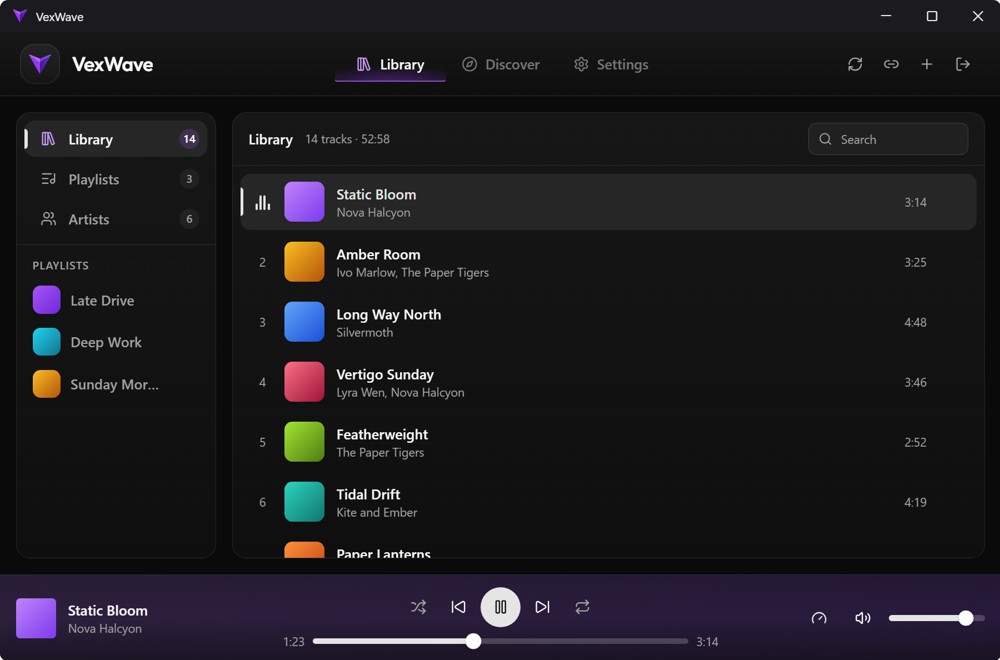

<div align="center">


# VexWave

**A desktop music player connected to your server.**

<p>
  <a href="https://v3.wails.io"></a>
  <a href="https://go.dev"></a>
  <a href="https://react.dev"></a>
  <a href="https://www.typescriptlang.org"></a>
</p>

<p>
  <a href="https://github.com/VexWave/vex-app/actions/workflows/ci.yml"></a>
  &nbsp;
  <a href="https://github.com/VexWave/vex-app/releases/latest"></a>
  &nbsp;
  <a href="https://github.com/VexWave/vex-app/releases"></a>
</p>

<br>



</div>

<div align="right">

<a href="https://vexwave.github.io/"></a>

</div>

## Features

| Feature | What it does |
| --- | --- |
| **Your library** | Your whole collection lives on your own server. |
| **Import from a link** | Add a track directly from a YouTube or SoundCloud URL. |
| **Discover** | Search YouTube and SoundCloud in-app and load them into your library. |
| **Equalizer** | Ten sliders to shape the sound. |
| **Effects** | Adjust the speed, drive and reverb. |
| **Discord Rich Presence** | Put what you're listening to on your profile. |

## Installation

> [!IMPORTANT]
> VexWave is the client half only. Every track streams from a server you run, so set one up first:
> **[VexWave/vex-backend](https://github.com/VexWave/vex-backend)**.

### From a release

Download from the **[latest release](https://github.com/VexWave/vex-app/releases/latest)**:

| OS | Download |
| --- | --- |
| Windows | `VexWave-installer.exe`, then run it |
| Debian, Ubuntu | `VexWave-linux-amd64.deb`, then `sudo apt install ./VexWave-linux-amd64.deb` |
| Fedora | `VexWave-linux-amd64.rpm`, then `sudo dnf install ./VexWave-linux-amd64.rpm` |

On Linux, VexWave needs GTK 4 and WebKitGTK 6.0 (Ubuntu 24.04+, Debian 13+, Fedora 39+), and GStreamer's good and
libav plugins to play every format. It doesn't update itself: install each new release the same way.

> [!NOTE]
> First launch downloads yt-dlp, ffmpeg and deno before showing the login screen.

### From source

Needs **[Go](https://go.dev) 1.27**, **[Bun](https://bun.sh) 1.4+** and the **[Wails](https://v3.wails.io) v3.1.0** CLI.
The Windows installer also needs **[NSIS](https://nsis.sourceforge.io)** (`makensis` on `PATH`). On Linux, install a C
compiler and the GTK 4 and WebKitGTK 6.0 headers first (`sudo apt install build-essential libgtk-4-dev libwebkitgtk-6.0-dev`).

```sh
git clone https://github.com/VexWave/vex-app.git
cd vex-app
go install github.com/wailsapp/wails/v3/cmd/wails3@v3.1.0
```

| Command | What it does |
| --- | --- |
| `wails3 task dev` | Develop, with Vite HMR |
| `wails3 task build` | Build `bin/VexWave.exe` (`bin/VexWave` on Linux) |
| `wails3 task package EXTRA_TAGS=stable` | Build the stable `bin/VexWave-amd64-installer.exe` (`bin/VexWave.deb` and `bin/VexWave.rpm` on Linux) |
